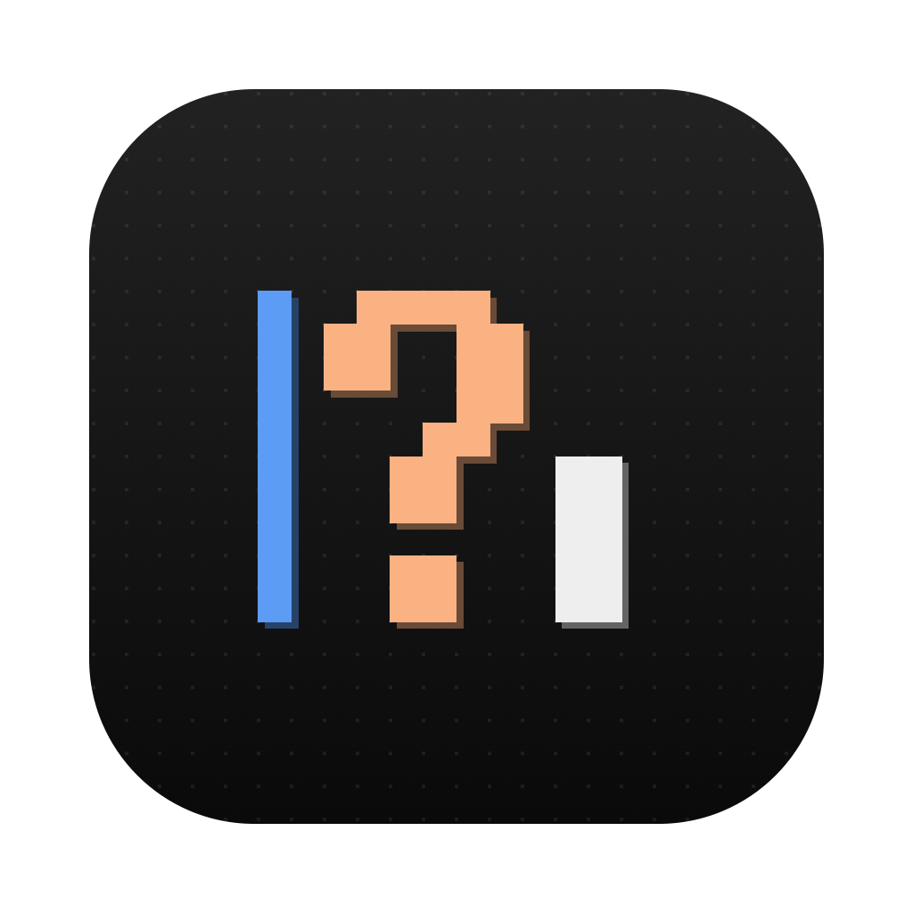
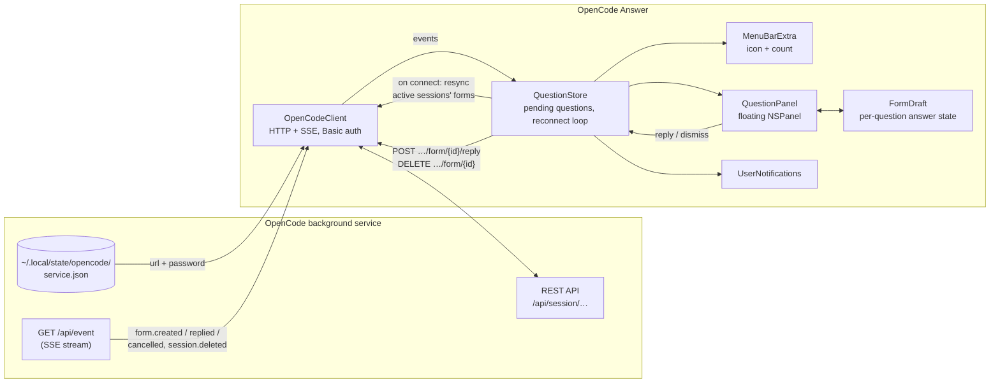

# OpenCode Answer

A macOS menu bar app that shows [OpenCode](https://opencode.ai)'s questions in a floating panel, so you can answer them without switching to the terminal.

When an agent asks something (pick an option, confirm, type a value), the panel pops up in the top-right corner of the screen you're on, together with a notification. Answer there or in the terminal; whichever you use, the other one clears.

<p align="center"></p>

## Requirements

- macOS 14 or later
- OpenCode V2, using the shared background service (the default; the TUI starts it for you). Sessions started with `opencode --standalone` run a private server and won't show up.
- Xcode or the Xcode Command Line Tools, to build. Full Xcode is needed for the app icon; without it the app builds without one.

## Install

```sh
git clone https://github.com/preacherxp/opencode-answer.git
cd opencode-answer
./build.sh --install
open "/Applications/OpenCode Answer.app"
```

`./build.sh` alone builds `build/OpenCode Answer.app` without installing it.

On first launch, allow notifications when macOS asks. In the menu bar menu you can turn on **Launch at Login**, and turn the pop-up panel and notifications on or off.

To check which version you have, choose **About OpenCode Answer** from the menu. To update, `git pull` and run `./build.sh --install` again. To uninstall, quit the app from its menu and delete `/Applications/OpenCode Answer.app`.

### Troubleshooting

The first line of the menu bar menu shows the connection state. If it says **Disconnected · service not running**, check the OpenCode service:

```sh
opencode service status
```

The app reconnects on its own once the service is back, including after it restarts on a new port.

## Usage

| Key | Action |
| --- | --- |
| ⌘1–9 | Pick an option |
| ⌘↩ | Send the answer |
| Esc | Hide the panel (the question stays pending) |
| ⌘O | Show the panel (from the menu) |

## Architecture



- **`OpenCodeClient`** (`Sources/OpenCodeAnswer/OpenCodeClient.swift`) reads the service registration (honoring `XDG_STATE_HOME`), subscribes to `/api/event` and wraps the session and form endpoints.
- **`QuestionStore`** (`QuestionStore.swift`) keeps the list of pending questions. It reconnects with backoff, re-reading `service.json` each time because the service picks a new port and password on restart. The event stream has no replay, so after every connect it rebuilds the list from the active sessions' forms.
- **`FormDraft`** (`FormDraft.swift`) holds what you've typed or picked for each question, so switching between questions keeps your input, and turns it into the answer payload.
- **`App.swift`** wires it to the UI: the menu bar item, the non-activating floating panel (`QuestionView.swift`), and notifications.

## Development

```sh
swift build          # debug build
./build.sh           # release .app bundle in build/
```

The version lives in `VERSION`; `build.sh` writes it into the app's Info.plist and uses the commit count as the build number.

The icon is pixel art drawn by `icon/make-icon.swift`. After editing the art there, run `swift icon/make-icon.swift icon` and rebuild; `build.sh` compiles `icon/AppIcon.icon` with Xcode's `actool`.

## License

[MIT](LICENSE)

<sub>If it saves you a few trips to the terminal, you can [buy me a coffee](https://buymeacoffee.com/michal.hachula).</sub>
